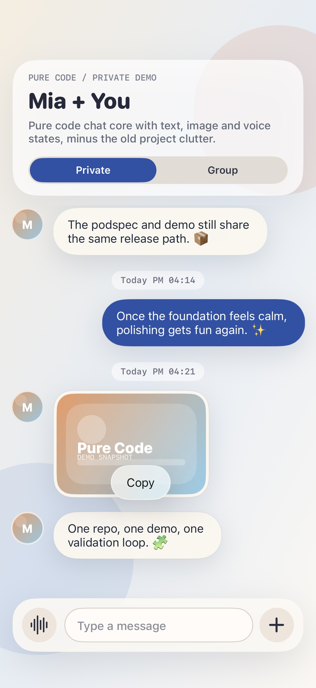
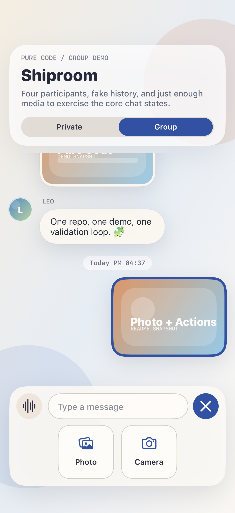
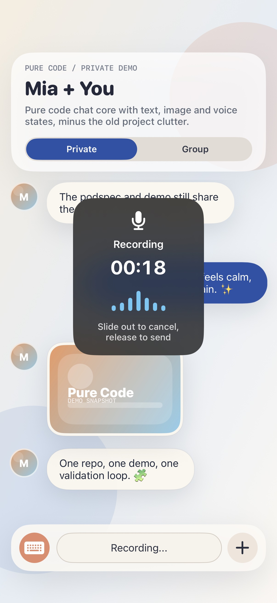
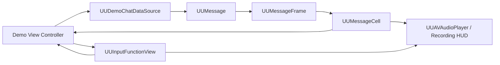
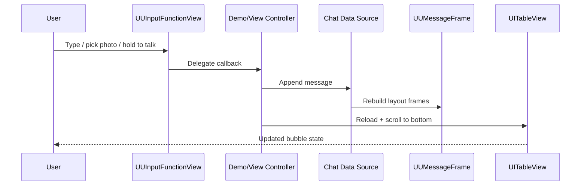

# UUChatTableView

UUChatTableView is a lightweight Objective-C UIKit chat UI for teams that want the core chat experience without dragging in a large product shell. It focuses on the pieces that matter in day-to-day messaging interfaces: message models, layout calculation, bubble rendering, image preview, voice playback, and a polished pure-code input bar.

> **What you get**
>
> A demo-ready chat surface with text, image, and voice states, plus a codebase that is small enough to understand quickly and extend safely.

## Preview

<p align="center">
  
  
  
</p>

<p align="center">
  <sub>Copy Menu</sub>
  &nbsp;&nbsp;&nbsp;
  <sub>Media Actions</sub>
  &nbsp;&nbsp;&nbsp;
  <sub>Recording HUD</sub>
</p>

## Quick Start

### Fastest path

```bash
./SetupDemo.command
open Demo/UUChatTableViewDemo.xcworkspace
```

### Manual path

```bash
cd Demo
xcodegen generate
pod install
open UUChatTableViewDemo.xcworkspace
```

> **Inside the demo**
>
> One-to-one chat, multi-participant chat, image bubbles, voice bubbles, pull-to-load history, inline media actions, copy menu, and recording HUD presentation.

## Installation

```ruby
pod 'UUChatTableView'
```

For local development:

```ruby
pod 'UUChatTableView', :path => '..'
```

> **Platform**
>
> Minimum supported version: `iOS 13.0`

## Typical Usage

The common integration path is small: listen to input callbacks, append a message into your own source of truth, rebuild frames, and render them through the chat table view.

```objc
@interface ChatViewController () <UUInputFunctionViewDelegate, UUMessageCellDelegate>
@end

- (void)inputFunctionView:(UUInputFunctionView *)inputFunctionView didSendText:(NSString *)text;
- (void)inputFunctionView:(UUInputFunctionView *)inputFunctionView didSendImage:(UIImage *)image;
- (void)inputFunctionView:(UUInputFunctionView *)inputFunctionView didSendVoiceData:(NSData *)voiceData duration:(NSInteger)duration;
- (void)inputFunctionView:(UUInputFunctionView *)inputFunctionView didSelectCustomActionItem:(UUInputActionItem *)actionItem;
- (void)messageCell:(UUMessageCell *)cell didTapAvatarForUserIdentifier:(NSString *)userIdentifier;
```

Custom actions can be added with a small configuration block:

```objc
self.inputFuncView.customActionItems = @[
    [UUInputActionItem actionItemWithIdentifier:@"file"
                                          title:@"File"
                                systemImageName:@"doc"]
];
```

## Highlights

- **Focused chat surface**: text, image, and voice are all supported without pulling in unrelated product logic.
- **Pure-code input bar**: no storyboard dependency, with expandable media actions and voice mode built in.
- **Modern media entry**: photo picking uses `PHPickerViewController` on supported systems.
- **Voice feedback that feels alive**: the recording HUD shows duration, waveform level, and cancel messaging.
- **Customizable extension point**: add your own action items under the input bar without rewriting the component.

## At a Glance

| Area | Included |
| --- | --- |
| Message types | Text, image, and voice |
| Conversation styles | One-to-one and multi-participant demo scenes |
| Input experience | Text send, photo picker, camera entry, voice recording, custom actions |
| Media APIs | `PHPickerViewController` on iOS 14+ |
| UX details | Copy menu, image preview, waveform HUD, voice playback |
| Setup | XcodeGen + CocoaPods |

## Architecture Overview

The project stays intentionally compact: input drives controller callbacks, the data source produces messages, layout frames shape presentation, and cells render the final bubble states.



## Message Flow

The runtime flow is straightforward: user input becomes a message, the message becomes layout data, and the table view refreshes into a new visible state.



## Core Building Blocks

| Type | Role |
| --- | --- |
| `UUMessage` | Message model for sender, content, timestamp, and voice metadata |
| `UUMessageFrame` | Layout calculator for bubble geometry and cell height |
| `UUMessageCell` | Bubble renderer for text, image, and voice content |
| `UUInputFunctionView` | Pure-code input bar with media actions and voice mode |
| `UUAVAudioPlayer` | Voice playback wrapper |
| `UUImageAvatarBrowser` | Full-screen image preview helper |

## Project Layout

- `Class/`
  The reusable library source: models, layout, message cells, input UI, audio playback, and image preview helpers.
- `Demo/`
  A pure-code example app generated by XcodeGen and wired through CocoaPods.
- `Docs/Screenshots/`
  README image assets exported from the demo app.
- `SetupDemo.command`
  One-step setup script for generating the demo project and installing dependencies.
- `UUChatTableView.podspec`
  CocoaPods definition used for linting and release packaging.

## Local Verification

The current repository has been verified with:

- `xcodegen generate`
- `pod install`
- `xcodebuild -workspace Demo/UUChatTableViewDemo.xcworkspace -scheme UUChatTableViewDemo -sdk iphonesimulator -configuration Debug -derivedDataPath /tmp/uuchat-deriveddata CODE_SIGNING_ALLOWED=NO build`
- `pod lib lint UUChatTableView.podspec --allow-warnings --skip-tests`

> **Tip**
>
> GitHub renders Mermaid diagrams natively. If your local Markdown preview does not, the source is still valid and will render correctly on GitHub.
